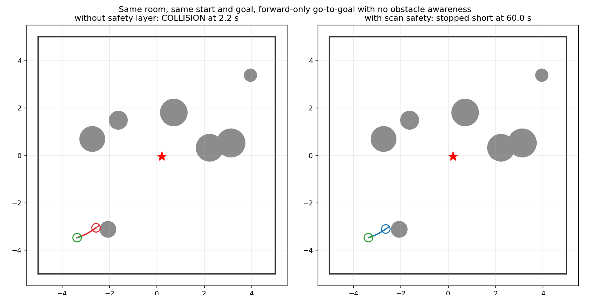
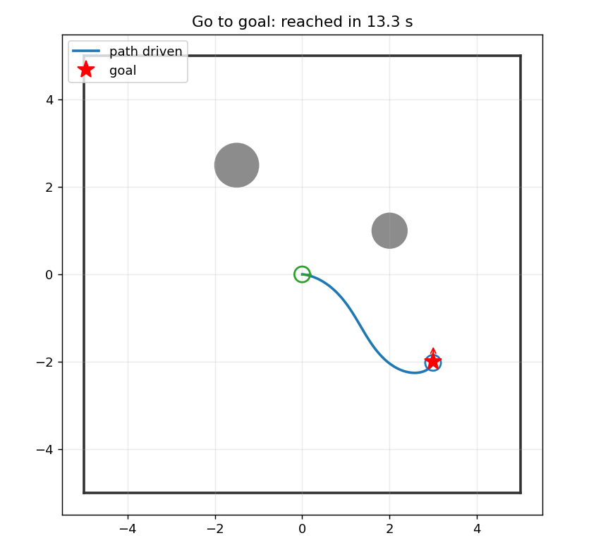
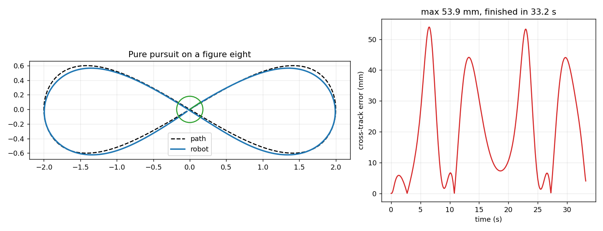
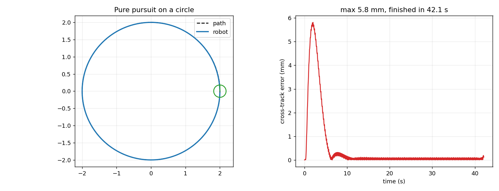
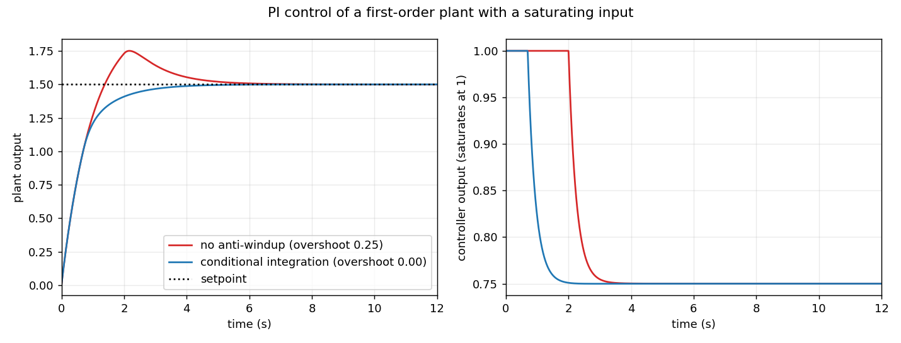
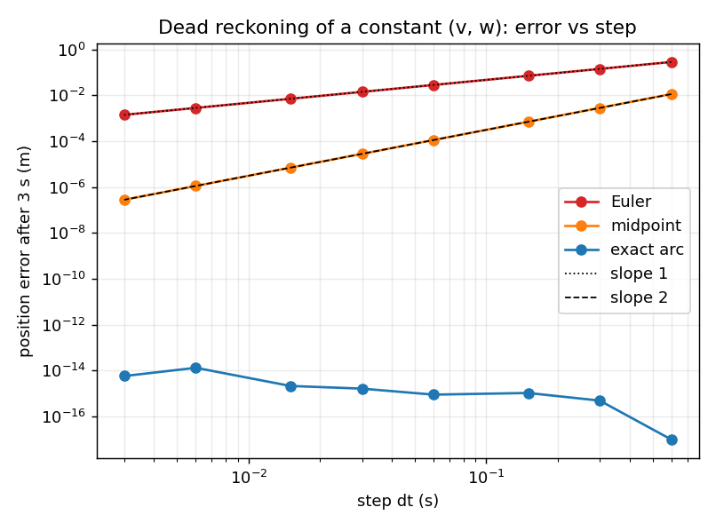

# ros2-robot-control

A small robot control package for a **differential-drive robot**, built as a dependency-light **pure-Python core** with thin **ROS 2 (rclpy) nodes** around it
and a deterministic simulator to run both:

* differential-drive **kinematics and wheel odometry** (exact arc integration, checked against Euler and midpoint),
* a **PID** controller (filtered derivative on the measurement, anti-windup by conditional integration),
* **go-to-goal** with the polar-coordinate law of Aicardi et al. (1995), including driving in reverse and a final turn on the spot,
* **pure pursuit** path following (Coulter, 1992) for lines, circles and self-crossing paths,
* a **scan-based safety layer**: the robot's speed is limited to what it can still stop from, given a lidar scan, on the arc it is about to drive,
* a **command multiplexer with a watchdog** (teleop beats navigation; silence means stop).

> **Status, honestly.** Everything here runs in simulation only. Nothing has been run on a physical robot, and the simulator is a small 2-D
> model written for this package (first-order motor lag, a disc footprint, a lidar made by ray casting), not Gazebo and not a model of any real
> hardware. The tests show that the code does what its equations say and that the ROS 2 plumbing works; they cannot show that a real robot with
> real motors, wheel slip and sensor noise behaves the same. The safety layer is a **reactive** guard: it prevents contact, it does not plan around
> anything.

## Quick start

```bash
pip install -e ".[dev]"          # numpy, matplotlib (figures), pytest

robot dogrulama                  # run the 12 validation experiments (about 15 s)
robot git --hedef 3 -2 --aci 90 --png examples/go_to_goal.png
robot takip --yol sekiz --png examples/figure_eight.png
robot guvenlik --png examples/safety_layer.png
pytest                           # 88 tests (the ROS 2 tests skip themselves without rclpy)
```

The command-line tokens are ASCII-transliterated Turkish (`git` = go, `takip` = follow, `guvenlik` = safety, `dogrulama` = validation, `hedef` = goal,
`yol` = path) and the output is Turkish; the code, the tests and this README are English.

| command | what it does |
|---|---|
| `robot kinematik` | error of the Euler, midpoint and exact-arc integrators against the analytic arc |
| `robot git --hedef X Y [--aci DEG] [--baslangic X Y DEG] [--dunya bos\|oda] [--guvenliksiz] [--sadece-ileri]` | drive to a pose in the simulator |
| `robot takip --yol cember\|sekiz\|dogru [--bakis M] [--hiz V] [--gecikmesiz]` | follow a path with pure pursuit |
| `robot guvenlik [--oda N]` | the same random rooms with and without the safety layer |
| `robot pid` | PI control of a saturating plant with and without anti-windup |
| `robot ros` | is rclpy available, and how to start the nodes |
| `robot dogrulama` | all validation experiments, exit code 1 if any fails |

`--png FILE` writes the figure of a run.

## ROS 2

The nodes are ordinary rclpy nodes started as `python3 -m robot_kontrol.ros.<name>` (no colcon build, no ament index): tested on **ROS 2 Jazzy**.

```
go_to_goal_node ┐
                ├─ cmd_vel_nav ─▶ mux_node ─ cmd_vel_muxed ─▶ safety_node ─ cmd_vel ─▶ sim_node ─▶ odom, scan, collision
pure_pursuit_node ┘                  ▲                              ▲                      │
teleop (yours) ── cmd_vel_teleop ────┘                              └──────── scan ◀───────┘
```

| node | subscribes | publishes | notes |
|---|---|---|---|
| `sim_node` | `cmd_vel` | `odom`, `scan`, `collision` | wheel odometry without noise (equals the true pose); no `tf`; the base stops if commands stop for `cmd_timeout` |
| `mux_node` | `cmd_vel_teleop` (priority 10), `cmd_vel_nav` (priority 1) | `cmd_vel_muxed`, `active_source` | each source expires after its timeout; all expired → publishes a stop (`none`) |
| `safety_node` | `cmd_vel_muxed`, `scan` | `cmd_vel`, `free_distance` | limits forward speed from the scan, then clamps and slews (a_max, alpha_max); stale command → stop; **forward motion without a fresh scan is refused** |
| `go_to_goal_node` | `odom`, `goal_pose` (`PoseStamped`, odom frame) | `cmd_vel_nav`, `goal_reached` | unstable gains are refused at start-up |
| `pure_pursuit_node` | `odom`, `path` (`nav_msgs/Path`, odom frame) | `cmd_vel_nav`, `goal_reached` | a new path restarts the progress along it |

All parameters are in [`config/robot.yaml`](config/robot.yaml) (doubles need a decimal point). Two launch files start a whole simulated robot:

```bash
ros2 launch launch/sim_goto.launch.py        # then:  ros2 topic pub --once /goal_pose geometry_msgs/msg/PoseStamped "{pose: {position: {x: 3.0, y: -2.0}, orientation: {w: 1.0}}}"
ros2 launch launch/sim_pursuit.launch.py     # then publish a nav_msgs/Path on /path
```

No ROS on your machine (macOS, plain Linux)? The whole suite, including the ROS 2 tests, runs in the official container:

```bash
bash tools/ros_container_test.sh             # needs Docker (Colima or Docker Desktop on macOS); extra arguments go to pytest
```

## How it is validated

Nothing is checked only against itself. `robot dogrulama` (and the tests) compare each piece with a closed form, a brute-force reference, a planted truth or
an independent method:

| piece | checked against | result |
|---|---|---|
| exact arc integrator, Euler, midpoint | the analytic circular arc, halving the step | exact: 1e-15 m for any step; Euler order 1.00; midpoint order 2.00 |
| wheel odometry | the analytic arc, and one tick vs a thousand | 2e-13 m after 3 s |
| simulated motor lag | the first-order step response and its integral | 4e-16 for dt = 0.1, 0.01, 0.001 s (exact discretisation) |
| PID | steady state of a P-controlled lag (`kp/(1+kp)`), integral action, anti-windup | 0.800000 vs 0.8; PI reaches 1; overshoot 0.251 without anti-windup, 0.000 with it; the integral settles at `u_ss / ki` in both |
| go-to-goal | the planted decay `rho(t) = rho0 exp(-k_rho t)` on a straight approach; 25 random poses | fitted rate −0.6002 (theory −0.6); 25/25 reach position and heading; the distance never grows |
| go-to-goal in reverse | a goal 3 m directly behind | 2.970 m path (3 m minus the 3 cm tolerance), heading error 0 |
| pure pursuit | a circle (the robot's own circle coincides with the path for any lookahead), a 0.6 m initial offset, a figure eight | 0.16 mm max error on the circle; offset gone after 10 s; both loops of the eight driven, 9.89 of 9.98 m |
| arc free distance (safety) | brute-force stepping along the arc, and the closed form for a point on it | 150 random scenes within 2 mm (the brute-force step); closed form to 4e-16 m |
| lidar raycast | sphere tracing (an independent method) | 181 hits, worst difference 4e-7 m, no hit/miss disagreement |
| safety layer | the same 12 random cluttered rooms with and without it | 7 collisions without; **0 with** |
| mux and limiter | priority/timeout sequences; random commands against the slew limits | exact; slew excess 3e-15 |
| ROS 2 layer | 10 integration tests, each node a separate process over real DDS, plus a real launch file | all pass; breaking the safety limiter or swapping the mux priorities makes the matching test fail |

### What the validation caught during development

These were real bugs in my first versions, found because something was compared with an independent reference:

* **Reverse go-to-goal was not straight.** For a goal 3 m behind, the path was 4.01 m long: in reverse I flipped the robot's heading by π but not the goal's.
  The final turn on the spot hid it (200/200 runs still converged). Found by checking the path length of the reverse case; now 2.97 m.
* **Pure pursuit skipped half of a figure eight.** The progress search looked 400 points ahead, which on a 402-point path includes the end point lying at the
  crossing: the robot jumped to the end and drove 4.97 m of 9.98 m while reporting "done". The search is now limited to an arc length ahead.
* **Pure pursuit crawled along a far-away path.** With the robot farther from the path than the lookahead distance, the lookahead circle misses it and the
  fallback aimed at the far end; a 0.6 m offset was still 0.557 m after 20 s. It now aims one lookahead of arc length ahead of the closest point.
* **Braking used the straight-line distance to the end.** On a loop the end is the start, so the robot crawled until it had moved away; and the profile
  `sqrt(2 a d) + v_min` asks for unbounded deceleration near the goal (arrival at about 0.3 m/s). Now: path length left, constant deceleration.
* **The simulator integrated the lagged speed at its end-of-step value** (first order in dt, 5 % position error at dt = 0.1). It now integrates the exact step average.
* **A cross-track metric flattered the figure eight.** At the crossing the nearest point of the *other* branch made the error look up to 10.7 mm smaller;
  the error is now measured against the branch being followed.
* My own tests had wrong geometry twice (an obstacle I believed to be on the arc was 0.236 m off it; a ray I believed to miss a circle grazed it). The
  library was right both times.

## The safety layer: what it guarantees and what it does not

For a command `(v, w)` with `v > 0` the robot's centre moves on an arc of curvature `w / v`. `free_distance` finds in closed form the arc length at which the
disc of the robot's radius first touches a scan point. The speed allowed is `sqrt(2 · decel · (free − margin))`: the speed from which it can still stop in the
room left. The command is scaled down keeping its curvature. Reversing and turning on the spot are not limited (there is no rear scan, and a disc turning in
place sweeps nothing new).

In the random-room experiment the guarded robot never touched anything (0 collisions in 12 rooms in the validation and 0 in 20 rooms in the tests, against 7 and
10 without it). Charging a wall at 0.5 m/s it stops 6 cm short of it. But:

* it is a **guard, not a planner**: in that experiment the guarded robot reached the goal in 4 of 12 rooms and stopped behind an obstacle in the other 8
  (a goal-seeking law with no obstacle awareness has nowhere to go);
* it rests on assumptions the tests satisfy by construction: a disc footprint, a scan that sees every obstacle (360 beams, 6 m), the deceleration it assumes
  being the one the robot delivers (the limiter slews at the same 0.8 m/s²), and a motor lag of 0.15 s. The lag already uses most of the margin: in the wall
  charge the robot came to rest 0.08 m inside the 0.10 m margin, so a slower motor needs a larger one. A blind spot, a thin obstacle between beams or a moving
  obstacle can break it too;
* nothing protects the robot while reversing.



## Figures

| | |
|---|---|
|  |  |
|  |  |



## Limitations

* Simulation only; never run on hardware. No wheel slip, no sensor noise, no odometry drift (the simulated odometry equals the truth), no `tf`.
* Tested on ROS 2 **Jazzy** only. The nodes use default QoS (reliable, depth 10) on every topic; a real lidar driver publishing best-effort would need
  its QoS matched. Frames are assumed: goals and paths are taken in the odometry frame.
* One robot model (differential drive, disc footprint), first-order motor lag, flat floor.
* Go-to-goal and pure pursuit have no obstacle avoidance; pure pursuit cuts corners on tight curves (the figure eight's ends show up to 5 cm).
* The ROS 2 tests run in real time (about 3 minutes in total) and need a working DDS loopback.

## Project layout

```
src/robot_kontrol/
    geometry.py kinematics.py limits.py pid.py          the building blocks
    go_to_goal.py pure_pursuit.py safety.py mux.py      the controllers
    sim.py scenarios.py                                 the simulator and the closed-loop runs that every test and figure shares
    checks.py cli.py plots.py                           validation, command line, figures
    ros/                                                sim, mux, safety, go-to-goal and pure-pursuit nodes
config/robot.yaml  launch/*.launch.py  tools/ros_container_test.sh  tests/  examples/
```

CI (GitHub Actions): the core on Python 3.9, 3.12 and 3.13, and a second job in the `ros:jazzy-ros-core` container that runs everything including the ROS 2 tests.

## References

* Aicardi, Casalino, Bicchi, Balestrino, *Closed loop steering of unicycle-like vehicles via Lyapunov techniques*, IEEE Robotics & Automation Magazine, 1995.
* Coulter, *Implementation of the Pure Pursuit Path Tracking Algorithm*, CMU-RI-TR-92-01, 1992.

## License

MIT
